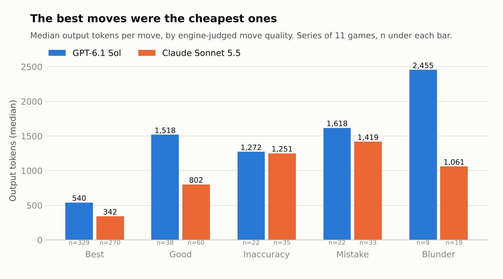
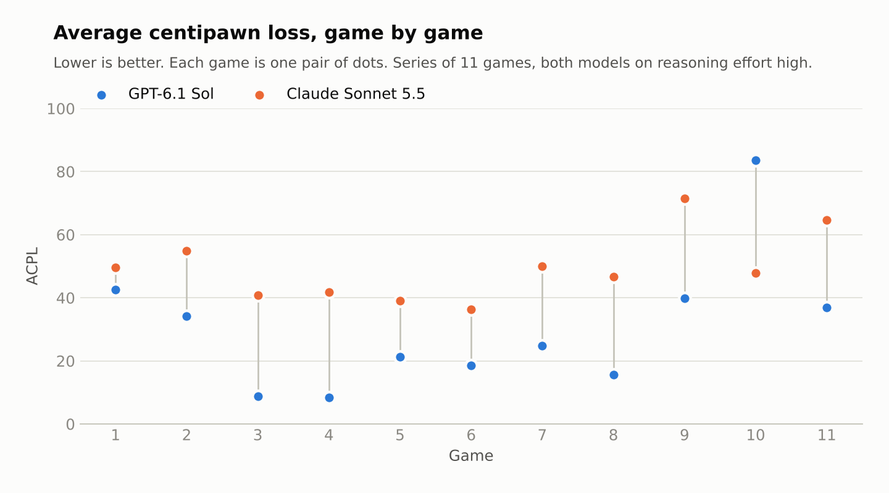

# Token Clock

**How much does a language model "think" before each chess move, and does thinking more give better moves?**

This repository holds the open data and analysis behind the Velmoxia Token Clock: a way of watching and measuring games between AI models in which the clock is not seconds but **output tokens**, the amount of text (visible and hidden reasoning) a model produces before it commits to a move.

Everything here is from one small experiment. It is published so that others can check it, criticise it and repeat it.

Status: first data release, November 2026. Independent work by [Velmoxia](https://velmoxia.com), a family studio in Lisbon. Not sponsored by, or affiliated with, any AI company.

## What was done

- Two models played chess against each other through their public APIs on 16 November 2026: **Claude Sonnet 5.5** (`claude-sonnet-5-5`, Anthropic) and **GPT-6.1 Sol** (`gpt-6.1-sol`, OpenAI).
- **Series: 11 games**, colours alternating, both models on the same reasoning effort setting (`high`), 16,000 maximum output tokens per move, referee version 1.2.
- **Pilots: 2 earlier games**, kept separate. Pilot 1 used each provider's default effort (Claude `high`, GPT `medium`); pilot 2 used `high` for both.
- No chess engine was available to the players. A script acted as referee: it sent the position and received one move.
- Afterwards, every position was evaluated with Stockfish 17.1 to judge the quality of each move.

### What each model saw on every move

System prompt (identical for both):

```
You are playing a game of chess against another AI model. You must choose your moves yourself: do not use, simulate or call any chess engine, database or external tool. Answer in exactly two lines:
MOVE: <your move in standard algebraic notation, e.g. Nf3, exd5, O-O, e8=Q>
COMMENT: <one short sentence about your idea, max 15 words>
```

User message: the colour to move, the moves so far, the position in FEN, and **the list of legal moves**. Each move is a fresh request with no memory of earlier reasoning.

Rules: a third invalid or illegal answer in a game loses it; 160 half-moves without a result is a draw; network failures are retried and do not count.

## Results in short

Series score: **GPT-6.1 Sol 9.5, Claude Sonnet 5.5 1.5** (one draw, one Claude win, nine GPT wins). 837 half-moves, no illegal moves. Total API cost of the series: 9.28 US$.

| | Claude Sonnet 5.5 | GPT-6.1 Sol |
|---|---|---|
| Moves | 417 | 420 |
| Average centipawn loss (lower is better) | 48.2 | 29.7 |
| Played the engine's first choice | 45.6% | 60.5% |
| Mistakes and blunders | 12.5% | 7.4% |
| Output tokens, whole series | 308,775 | 537,727 |
| Output tokens per move, median | 629 | 772 |





Three observations, stated carefully:

1. **Between the two models, more tokens went with better play.** GPT produced about 74% more output and had the lower centipawn loss in 10 of the 11 games.
2. **Within each model, it is the other way round.** The moves each model spent most tokens on were, on average, its worse ones. Rank correlation between tokens and centipawn loss: +0.40 for Claude (95% interval +0.32 to +0.48) and +0.31 for GPT (+0.21 to +0.40). **This is an association, not a cause: it is not evidence that thinking more makes a model play worse.** A plausible reading is that the models spend more where the position is hard, and hard positions produce more errors. This data cannot separate that from other explanations.
3. **That within-model link is fragile.** It holds without the opening moves, but shrinks to +0.10 (Claude) and +0.22 (GPT) when only roughly balanced positions (within 2 pawns) are kept, and those are only about a fifth of the non-opening moves, because most games became one-sided early.

Full tables: [RESULTS.md](RESULTS.md).

## Limitations

Read these before quoting any number.

- **11 games, not 837 independent experiments.** Every game opened 1.e4 c5 2.Nf3 (Sicilian Defence); there are only 2 distinct move sequences after 10 half-moves and 6 after 20. Much of the opening play is therefore repeated, and the games are not a varied sample of chess positions.
- **One series, two models, one day.** No repetition, so there is no estimate of how much the score would change on another run. The score says who won this series, not which model is stronger at chess.
- **The legal moves were given to the models.** Zero illegal moves is therefore not evidence of board understanding.
- **Tokens are not a common unit.** Each provider counts tokens with its own tokenizer and reports hidden reasoning in its own way. For GPT the reasoning tokens are reported separately; for Claude they are included in output tokens but not itemised. Comparisons of token counts between providers are approximate.
- **"Same effort" is a label, not a measurement.** `high` is a setting each provider defines for itself.
- **Model versions are whatever the APIs served on the day.** The model names returned by the APIs matched the ones requested in every call.
- **Engine judgement has limits.** Stockfish at 1.5 million nodes per position is far stronger than either player, but centipawn loss is noisy in won or lost positions; scores are capped at 1000.
- **Moves within a game are not independent.** Intervals are bootstrapped over whole games for that reason, and with 11 games they are wide.
- **The pilots are two single games** under different settings and an earlier referee version, without separate reasoning-token counts. They are included for completeness and support no conclusion.

## What is in the repository

| Path | Content |
|---|---|
| `data/games.json` | All 13 games: settings, result, per-move output tokens, reasoning tokens where reported, seconds, usage and cost per game, and SHA-256 of the original logs |
| `data/pgn/` | One PGN per game (S01 to S11 series, P1 and P2 pilots), with tokens and seconds as move comments |
| `data/token_clock_moves.csv` | One row per move: tokens, engine evaluation before and after, centipawn loss, quality class, phase |
| `analysis/analyse.py` | Stockfish analysis that produces the CSV |
| `analysis/stats.py` | Produces `RESULTS.md` |
| `analysis/charts.py` | Produces the charts |

Not yet included: the referee script and the raw request and response logs (JSONL). Both will be added after clean-up. The SHA-256 of each original log is already in `games.json`, so later publication can be checked against it.

### Reproduce

```
pip install python-chess pandas scipy matplotlib
python analysis/analyse.py data/games.json data/token_clock_moves.csv 1500000 /path/to/stockfish
python analysis/stats.py data/token_clock_moves.csv RESULTS.md
python analysis/charts.py data/token_clock_moves.csv charts
```

Engine results can differ slightly between machines and thread counts.

### Move quality classes

Centipawn loss (CPL) is the engine evaluation before the move minus the evaluation after it, from the mover's side, never below zero. When the move played is the engine's first choice, CPL is set to 0: any difference there is search noise between two evaluations, not a loss by the player (the unadjusted value is kept in the `cpl_raw` column; this applies to 65 moves in the series). Best: CPL up to 10. Good: up to 50. Inaccuracy: up to 100. Mistake: up to 300. Blunder: above 300. Opening: the first 20 half-moves. Endgame: 12 pieces or fewer.

## Watch the games

- Full match, shown on the Token Clock (each position stays on screen in proportion to the tokens spent on the next move): https://youtu.be/oJRv2H-NFMc

## Next

A second series with more games per condition and several effort levels for the same model, which is the only way to test directly whether more reasoning buys better moves.

## Licence and credit

- Data, text and charts: [Creative Commons Attribution 4.0](LICENSE-DATA) (CC BY 4.0). Use them freely, with credit.
- Code: [MIT](LICENSE).

Suggested credit: *Velmoxia Token Clock (2026), https://github.com/velmoxia/token-clock*

The method description "Watching AI games in tokens: the Velmoxia Token Clock method" was registered at Safe Creative on 16 November 2026, no. 2611167664530. The registration records authorship and date; it does not restrict use of this data.

AI use: the referee, the analysis code and this text were written with the help of Claude (Anthropic), directed and checked by Bernardo Ramos Coelho.

Contact: velmoxia@gmail.com
